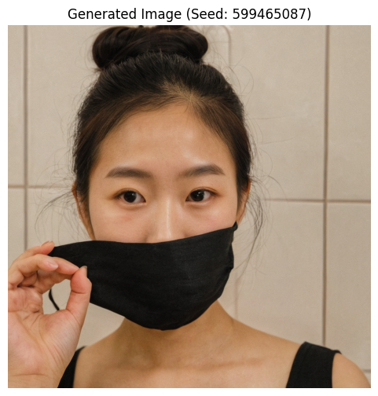
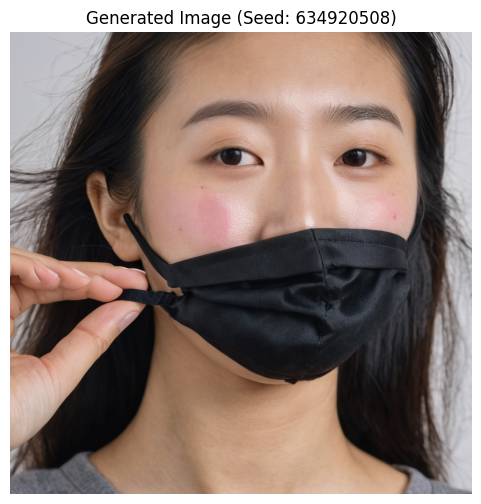

# mask_prompt_list
SDXL 마스크 프롬프트 리스트

### 프롬프트 

```bash
PROMPT = (
    "((removing face mask)), "
    "((hand pulling mask down)), "
    "((mid-action, caught in the moment)), "
    "black cloth face mask halfway removed, "
    "one hand gripping mask edge, "
    "candid close-up photo of a young East Asian woman, "
    "natural expression, slightly exhaling, "
    "bathroom, fluorescent indoor lighting, "
    "raw smartphone photo, photorealistic"
)

NEGATIVE_PROMPT = (
    "mask fully on, "
    "mask fully off, "
    "static pose, "
    "both hands down, "
    "worst quality, low quality, illustration, anime, cartoon, "
    "3d, painting, sketch, blurry, watermark, text, "
    "deformed face, bad anatomy, bad hands"
)
```



# 토큰 초과

```bash
PROMPT = (
    # 동작 강화
    "(((removing face mask))), "
    "(((hand pulling mask down))), "
    "((mask halfway off face)), "
    "motion blur on hand, "              # 움직임 암시
    "mid-gesture, dynamic moment, "

    # 피사체
    "candid close-up photo of a young East Asian woman, "
    "((tired, relieved expression)), "   # '자연스러운'보다 구체적
    "slightly parted lips, exhaling, "

    # 소품
    "black cloth face mask, "
    "one hand gripping mask edge, "
    "mask strap still around ear, "      # 디테일 추가

    # 환경
    "bathroom mirror selfie, "
    "fluorescent overhead lighting, "
    "slightly messy hair, "              # 현실감

    # 퀄리티
    "raw smartphone photo, "
    "film grain, "                       # 스마트폰 질감
    "natural skin texture, skin pores, " # 피부 사실감
    "photorealistic, hyperrealistic"
)

NEGATIVE_PROMPT = (
    "mask fully on, "
    "mask fully off, "
    "static pose, "
    "both hands down, "
    "studio lighting, "                  # 추가: 너무 인위적인 조명 제거
    "perfect skin, smooth skin, "        # 추가: 과도한 보정 제거
    "oversaturated, "                    # 추가
    "worst quality, low quality, illustration, anime, cartoon, "
    "3d, painting, sketch, blurry, watermark, text, "
    "deformed face, bad anatomy, bad hands, extra fingers"
)
```



